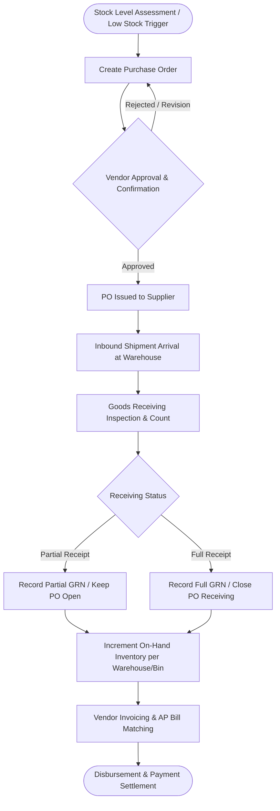
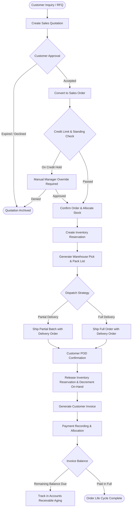

# DistribuCore

**A cloud-native, multi-tenant B2B Distribution Management System (DMS) engineered for small and medium-sized distributors, wholesalers, and supply chain operators.**

[](#project-status)
[-00ADD8.svg?logo=go)](#planned-technology-stack)
[](#planned-technology-stack)
[](#planned-technology-stack)
[](#multi-tenant-architecture)
[](#license)

---

## Table of Contents

- [Executive Summary](#executive-summary)
- [The Business Problem & Objectives](#the-business-problem--objectives)
  - [Industry Challenges](#industry-challenges)
  - [Strategic Objectives](#strategic-objectives)
- [Target Markets & User Personas](#target-markets--user-personas)
  - [Target Business Verticals](#target-business-verticals)
  - [Key User Personas](#key-user-personas)
- [Core Business Workflows](#core-business-workflows)
  - [1. Procure-to-Pay (P2P) Flow](#1-procure-to-pay-p2p-flow)
  - [2. Order-to-Cash (O2C) Flow](#2-order-to-cash-o2c-flow)
- [Planned Functional Modules](#planned-functional-modules)
- [System Architecture & Design](#system-architecture--design)
  - [High-Level Architectural Topology](#high-level-architectural-topology)
  - [Multi-Tenant Architecture & Data Isolation](#multi-tenant-architecture--data-isolation)
  - [High-Concurrency Stock Reservation Strategy](#high-concurrency-stock-reservation-strategy)
- [Planned Technology Stack](#planned-technology-stack)
- [Security & Compliance Considerations](#security--compliance-considerations)
- [Project Status & Implementation Scope](#project-status--implementation-scope)
- [Development Roadmap](#development-roadmap)
- [Contributing](#contributing)
- [License](#license)

---

## Executive Summary

**DistribuCore** is an enterprise-grade, multi-tenant B2B Distribution Management System tailored to solve the operational complexities of regional distribution businesses, building and construction material suppliers, and wholesale merchants.

Modern distribution businesses manage thousands of SKUs across decentralized warehouses, balance fluctuating vendor pricing, process high-volume partial shipments, and handle stringent credit controls. Generic off-the-shelf ERP platforms are frequently cost-prohibitive, bloated, and challenging to customize. Conversely, disconnected spreadsheets and entry-level accounting tools result in inventory stockouts, revenue leakage, unallocated cash receipts, and order fulfillment errors.

DistribuCore bridges this operational divide by unifying inventory visibility, procurement, sales orders, warehouse dispatch, partial delivery logistics, invoicing, and accounts receivable into a cohesive, high-performance web platform designed for SaaS multi-tenancy.

---

## The Business Problem & Objectives

### Industry Challenges

B2B distributors—especially in physical goods industries such as construction, hardware, and bulk wholesale—operate under razor-thin margins and strict delivery expectations. They face several systemic bottlenecks:

1. **Inventory Disconnect Across Multi-Site Facilities:** Lack of real-time visibility between central depots and regional warehouses causes over-promising to clients, stock hoarding, and costly inter-depot re-routing.
2. **Race Conditions in Order Promising:** Sales teams quote stock that has already been spoken for by concurrent orders, leading to fulfillment failures and compromised client trust.
3. **Complex Delivery Logistics:** Building and construction materials often require multi-stage, partial dispatches across multiple vehicles, with distinct delivery notes and physical Proof of Delivery (POD) confirmations.
4. **Disjointed Order-to-Cash Cycles:** Sales orders are disconnected from invoicing and payment collection. Inability to reconcile split payments and partial deliveries creates aging accounts receivable (AR) backlogs and disputed statements.
5. **Lack of Tenant Isolation in Custom Systems:** Distributors operating multiple trading entities or parent-child subsidiaries struggle with data segregation, consolidated reporting, and role-based operational permissions.

### Strategic Objectives

- **Operational Centralization:** Consolidate disparate procurement, sales, warehouse, and finance touchpoints into a unified, auditable single source of truth.
- **Strict Stock Integrity:** Enforce real-time inventory reservation engines that lock physical inventory against confirmed sales orders to eliminate stockouts and double-selling.
- **Granular Delivery Control:** Provide robust tracking for split shipments, partial fulfillment runs, backorders, and verifiable Proof of Delivery (POD).
- **Automated Financial Reconciliation:** Seamlessly bridge inventory movements with automated customer invoicing, credit limit validation, and payment allocation against line items and invoices.
- **Secure Multi-Tenancy:** Deliver an architecture that supports isolated tenant operations, allowing scalable deployment across independent operating companies or subscription tenants.

---

## Target Markets & User Personas

### Target Business Verticals

DistribuCore is domain-modeled for businesses characterized by high unit volumes, variable pack sizes, physical warehousing, and credit-based trading terms:

- **Building Material Distributors:** Cement, lumber, insulation, drywall, and structural component suppliers.
- **Construction Material & Equipment Suppliers:** Heavy hardware, electrical conduits, plumbing supplies, and finishing materials.
- **Wholesale & Trade Merchants:** Bulk commodities, industrial fasteners, tools, and commercial consumables.
- **Regional Distribution Companies:** Multi-branch trading networks supplying retail chains and contractor networks.

### Key User Personas

| Persona | Primary Responsibilities | Key Needs in DistribuCore |
|---|---|---|
| **Executive / Business Owner** | Strategic oversight, margin analysis, cash-flow monitoring | Executive dashboard, high-level AR aging, inventory turnover metrics, cross-branch visibility |
| **Warehouse & Logistics Manager** | Stock movements, warehouse space allocation, dispatch verification | Bin/location tracking, multi-warehouse transfer management, picker lists, goods receiving |
| **Procurement Specialist** | Vendor negotiations, purchase order generation, reorder points | Vendor price sheets, automated reorder thresholds, supplier lead-time tracking |
| **Sales Representative / Account Mgr** | Client quotes, order entry, credit term compliance | Real-time stock reservation status, tiered customer pricing, credit limit indicators |
| **Dispatch Coordinator / Driver** | Load staging, shipment route dispatch, delivery execution | Partial delivery tracking, digital Proof of Delivery (POD) capture, packing slips |
| **Finance & Accounts Receivable Officer** | Invoicing, credit limits, payment reconciliation, aging reports | Automated invoice generation from fulfillment events, split payment allocation, ledger integrity |

---

## Core Business Workflows

DistribuCore models the two foundational life cycles of wholesale operations: **Procure-to-Pay (P2P)** and **Order-to-Cash (O2C)**.

### 1. Procure-to-Pay (P2P) Flow

The procurement engine governs inventory replenishment from initial requirement detection through supplier settlement:



1. **Reorder & PO Generation:** Purchase orders are generated manually or flagged via minimum reorder triggers, specifying target receiving warehouses and agreed supplier unit costs.
2. **Goods Receipt Note (GRN):** When shipments arrive, receiving teams perform physical counts and quality checks against the PO. The system allows partial receipts, holding open remaining balances for backorders.
3. **Inventory Increment:** Confirmed GRNs atomically increment on-hand inventory balances at the designated warehouse and bin locations.
4. **Accounts Payable Matching:** Receiving documents are validated against vendor bills to prepare for scheduled payment reconciliation.

---

### 2. Order-to-Cash (O2C) Flow

The commercial engine handles quoting, credit validation, inventory reservation, partial dispatch, and cash collection:



1. **Quotation to Order Conversion:** Sales teams generate tiered pricing quotations. Upon customer approval, quotes transition into confirmed Sales Orders.
2. **Credit & Stock Reservation:** The system checks customer credit thresholds. Once validated, an inventory reservation is created, decrementing available-to-promise (ATP) stock while preserving on-hand stock counts until physical dispatch.
3. **Fulfillment & Dispatch:** Warehouse staff pick, pack, and prepare shipments. High-volume building materials often ship across multiple truckloads; DistribuCore supports multi-leg partial dispatches linked to distinct delivery orders.
4. **Proof of Delivery (POD):** Deliveries are confirmed via signed physical or digital receipt notes, updating the delivery status and triggering final on-hand stock deductions.
5. **Billing & AR Reconciliation:** Invoices are generated automatically from completed delivery notes (supporting billing per shipment). Inbound payments are recorded and allocated across specific invoices, adjusting customer balances and aging schedules.

---

## Planned Functional Modules

DistribuCore is structured as modular, domain-driven components:

```
DistribuCore Functional Modules
├── 1. Tenant & Identity Management
│   ├── Multi-Company & Tenant Onboarding
│   └── Role-Based Access Control (RBAC) & Security Policies
├── 2. Master Data Management
│   ├── Product Catalog, Units of Measure (UOM) & Tiered Pricing
│   ├── Supplier & Vendor Directory
│   └── Customer Accounts & Credit Risk Profiles
├── 3. Warehouse & Inventory Control
│   ├── Multi-Facility & Bin Location Management
│   ├── Stock Adjustments, Scrap & Internal Transfers
│   └── Real-Time Stock Reservation Engine
├── 4. Procurement & Inbound Logistics
│   ├── Purchase Requisitions & Purchase Orders (PO)
│   └── Goods Receiving Notes (GRN) & Backorder Tracking
├── 5. Sales & Outbound Fulfillment
│   ├── Quotation Management & Price Versioning
│   ├── Sales Order Management & Fulfillment Scheduling
│   └── Partial Deliveries, Route Dispatch & Proof of Delivery (POD)
├── 6. Financial Settlement & Receivables
│   ├── Automated Customer Invoicing (Per Delivery / Periodic)
│   ├── Payment Ingestion & Multi-Invoice Allocation
│   └── Accounts Receivable (AR) Aging & Credit Management
└── 7. Analytics & Operational Intelligence
    ├── Sales Performance, Velocity & Margin Analysis
    ├── Inventory Turnover & Dead Stock Identification
    └── Real-Time Executive KPI Dashboard
```

### Detailed Functional Breakdown

| Domain Module | Planned Capabilities & Scope |
|---|---|
| **Company & Tenant Management** | Multi-organization tenancy; tenant configuration; branch and subsidiary boundaries; localization settings (currency, time zones, fiscal year definitions). |
| **Authentication & RBAC** | Identity management; session and token governance; granular role assignments (Admin, Warehouse Clerk, Sales Rep, Finance Manager, Auditor); permission matrices. |
| **Catalog & Pricing Engine** | Master SKU directory; hierarchical categorization; multi-tier pricing matrices (retail, contractor, wholesale); volume discounts; flexible Units of Measure (UOM) conversion (e.g., pallets, bundles, individual units). |
| **Supplier & Customer CRM** | Comprehensive vendor profiles; vendor lead times; customer organization structures; custom credit limits; payment terms (e.g., Net 30, Cash on Delivery); tax identifiers. |
| **Multi-Warehouse Inventory** | Multi-site inventory tracking; aisle/rack/shelf/bin mapping; stock replenishment alerts; physical audit reconciliation; inter-warehouse transfers. |
| **Procurement & Receiving** | Supplier RFQs; PO creation and approval workflows; three-way matching readiness; multi-shipment receiving; damaged goods return logging. |
| **Sales & Reservation Engine** | Quotation lifecycles; instant quote-to-order transformation; Available-to-Promise (ATP) calculation; soft/hard reservation locks preventing double allocation. |
| **Delivery & Dispatch (POD)** | Staging queue; picking list generation; packing slip printing; multi-truck partial deliveries; digital/signed Proof of Delivery (POD) ingestion. |
| **Invoicing & Billing** | Immediate or batch invoicing triggered by delivery milestones; tax calculations; credit memo processing; line-item audit trails. |
| **Payment Allocation & AR** | Payment entry for bank transfers, checks, and electronic payments; partial and over-payment handling; multi-invoice FIFO/custom allocation; automated AR aging buckets (Current, 1-30, 31-60, 61-90, 90+ days). |
| **Business Analytics** | Executive dashboard displaying revenue velocity, gross margins, fulfillment cycle times, pending receivables, and top-selling SKUs. |

---

## System Architecture & Design

### High-Level Architectural Topology

```
┌─────────────────────────────────────────────────────────────────┐
│                      Client Layer (Browser)                     │
│               Next.js App Router / Tailwind / shadcn/ui         │
└────────────────────────────────┬────────────────────────────────┘
                                 │ HTTPS / REST JSON
                                 ▼
┌─────────────────────────────────────────────────────────────────┐
│                       Edge / API Gateway                        │
│             Reverse Proxy / SSL Termination / Rate Limiting     │
└────────────────────────────────┬────────────────────────────────┘
                                 │
                                 ▼
┌─────────────────────────────────────────────────────────────────┐
│              DistribuCore Application Backend (Go / Fiber)      │
│  ┌───────────────────────────────────────────────────────────┐  │
│  │ Middlewares: Tenant Context Extraction, AuthN/AuthZ (RBAC)│  │
│  └─────────────────────────────┬─────────────────────────────┘  │
│                                │                                │
│  ┌─────────────────────────────▼─────────────────────────────┐  │
│  │ Domain Services:                                          │  │
│  │ • Tenant & IAM      • Inventory & Stock Reservation       │  │
│  │ • Catalog & Pricing • Order Processing & Dispatch         │  │
│  │ • Procurement & GRN • Invoicing & Payment Allocation      │  │
│  └───────────────────────┬───────────────────────────┬───────┘  │
└──────────────────────────┼───────────────────────────┼──────────┘
                           │                           │
              Data Access  │              Distributed  │ Cache &
              via SQLC/pgx │              Locks        │ Ephemeral State
                           ▼                           ▼
┌──────────────────────────────────────┐  ┌───────────────────────┐
│         PostgreSQL Database          │  │      Redis Cache      │
│  • Tenant-isolated relational tables │  │  • Session store      │
│  • Row-Level Security (RLS) policies │  │  • Stock reservations │
│  • ACID transactional guarantees     │  │  • Distributed locks  │
└──────────────────────────────────────┘  └───────────────────────┘
```

---

### Multi-Tenant Architecture & Data Isolation

Data isolation is a primary architectural mandate for DistribuCore. To balance cost efficiency, operational maintenance, and rigorous data protection for SME distributors, the system uses a **Shared Database, Tenant Context Isolation Strategy**:

1. **Discriminator Column Enforcement:** Every tenant-scoped entity (customers, suppliers, products, orders, inventory, invoices) includes a mandatory, immutable `tenant_id` foreign key.
2. **Context-Driven Tenant Injection:** 
   - Inbound HTTP requests pass through a tenant identification middleware.
   - The verified `tenant_id` is derived strictly from cryptographic session credentials (JWT claims or secure session tokens), never blindly from client-supplied URL query parameters.
   - The verified context is injected into Go's standard `context.Context` and propagated across domain repositories.
3. **Database-Level Defense-in-Depth:**
   - PostgreSQL Row-Level Security (RLS) policies validate that database queries only touch rows corresponding to the active session's `tenant_id`.
   - SQL queries compiled via **SQLC** explicitly bind `tenant_id` parameters, mitigating accidental cross-tenant data leaks at both compile-time and runtime.

---

### High-Concurrency Stock Reservation Strategy

In wholesale and construction supply operations, multiple sales agents frequently negotiate for limited bulk inventories simultaneously. A robust reservation mechanism prevents double-allocation:

1. **Available-to-Promise (ATP) Equation:**
   $$\text{ATP} = \text{Physical On-Hand Stock} - \text{Active Reservations} - \text{Safety Stock}$$
2. **Distributed Reservation via Redis & PostgreSQL:**
   - When a sales order is submitted, the system acquires a short-lived distributed mutex (via Redis) for the target SKU and warehouse combination.
   - The engine validates ATP availability.
   - If available, a reservation record with a defined Time-To-Live (TTL) is inserted within a transactional database boundary, decremented from ATP.
3. **Fulfillment or Expiry:**
   - When goods are physically dispatched and marked with Proof of Delivery (POD), the reservation is converted: on-hand physical stock is permanently decremented, and the reservation is released.
   - If a sales order is cancelled or credit approval fails, the reservation is released immediately, returning stock to the ATP pool without data corruption.

---

## Planned Technology Stack

The planned technology stack prioritizes operational stability, type safety, low latency, and developer ergonomics:

| Layer | Technology | Architectural Justification |
|---|---|---|
| **Frontend Framework** | **Next.js** (React) | Modern App Router, Server-Side Rendering (SSR) for fast initial dashboard loads, and robust client-side interactions for complex data grids. |
| **Frontend Language** | **TypeScript** | Strict typing across state boundaries, component props, and API response contracts. |
| **Styling & UI Kit** | **Tailwind CSS** & **shadcn/ui** | Headless, accessible, customizable component architecture suitable for high-density enterprise interfaces, data tables, and input forms. |
| **Backend Language** | **Go (Golang)** | High-throughput, low-memory footprint, clean concurrency primitives for handling parallel requests, and rapid cold-start performance. |
| **Backend Framework** | **Fiber** (Go) | Express-inspired web framework engineered on Fasthttp, delivering zero memory allocation, sub-millisecond response latencies, and high concurrency for distribution workloads. |
| **API Architecture** | **RESTful API (JSON)** | Clear resource-oriented endpoints, standard HTTP semantics, straightforward caching, and predictable client integration. |
| **Primary Database** | **PostgreSQL** | Proven ACID compliance, advanced indexing, robust foreign key constraint guarantees, and native Row-Level Security (RLS) for multi-tenancy. |
| **Data Access Layer** | **SQLC & pgx** | Type-safe Go code generated directly from idiomatic SQL queries. Eliminates reflection-heavy ORM overhead while retaining compile-time query verification. |
| **Caching & In-Memory Store** | **Redis** | Sub-millisecond distributed caching, session persistence, rate limiting, and atomic distributed locking for inventory reservation. |
| **Containerization** | **Docker** | Consistent, reproducible build and runtime environments across local development and target container orchestration platforms. |

---

## Security & Compliance Considerations

- **Authentication & Identity Assurance:** Centralized identity verification supporting cryptographic JWTs with short lifespans paired with revocable refresh tokens stored in secure, `HttpOnly`, `SameSite` cookies.
- **Role-Based Access Control (RBAC):** Principle of Least Privilege (PoLP) enforced across all endpoints. Permissions are mapped to domain actions (e.g., `inventory:reserve`, `order:approve`, `invoice:void`).
- **Data Protection at Rest & in Transit:** All traffic enforced over TLS 1.3. Database storage encrypted at rest via AES-256. Sensitive customer data and banking credentials protected with field-level encryption where applicable.
- **Immutable Audit Logging:** Financial transactions, inventory adjustments, and administrative overrides generate append-only audit events recording the actor, timestamp, tenant ID, previous state, and updated state.
- **SQL Injection Prevention:** 100% parameterized queries generated via SQLC, avoiding string concatenation in data access layers.
- **Rate Limiting & Abuse Prevention:** Redis-backed token bucket rate limiting applied per tenant and IP address to protect against brute-force attacks and denial-of-service risks.

---

## Project Status & Implementation Scope

> [!IMPORTANT]
> **Current Repository Status:** `Phase 0 — Architectural Specification & Foundation`
> 
> The project is currently in the active architectural modeling and system design phase. The structural foundations, domain models, entity boundaries, and technology specifications defined in this document establish the baseline for implementation.
> 
> Implementation-specific application code, database migrations, and production container configurations will be rolled out systematically according to the development roadmap below.

---

## Development Roadmap

### Phase 0: System Architecture & Data Modeling (Completed)
- [x] Define business scope, operational workflows, and functional requirements.
- [x] Establish target technology stack and architectural topology.
- [x] Design multi-tenant data isolation and security models.
- [x] Define normalized database schema (ERD) covering core domains ([docs/architecture/DATABASE_SCHEMA.md](docs/architecture/DATABASE_SCHEMA.md)).
- [x] Specify OpenAPI / REST contract schemas for service boundaries ([docs/architecture/API_SPECIFICATION.md](docs/architecture/API_SPECIFICATION.md)).

### Phase 1: Core Platform & Authentication Foundation (Current)
- [x] Initialize repository structure (Go/Fiber backend workspace).
- [x] Set up Docker development environments (PostgreSQL, Redis) and migration scripts.
- [x] Implement multi-tenant context extraction and resolution middleware.
- [x] Implement Role-Based Access Control (RBAC) permission evaluation engine.
- [x] Implement user authentication, password hashing, and session management handlers.

### Phase 2: Master Data & Multi-Warehouse Inventory
- [x] Implement Product Master service (SKU, master products, and UOM units).
- [x] Implement Supplier and Customer directories with credit profile models.
- [x] Implement multi-warehouse, zone, and bin-level location schemas.
- [ ] Implement stock adjustment, transfer, and physical audit reconciliation logic.

### Phase 3: Procurement & Receiving (P2P)
- [ ] Implement Purchase Order (PO) creation, revision, and status management.
- [ ] Implement Goods Receiving Note (GRN) workflow with partial receipt support.
- [ ] Implement automated on-hand inventory increment upon verified receipt.
- [ ] Implement PO-to-GRN balance reconciliation and backorder tracking.

### Phase 4: Sales Orders & Stock Reservation Engine
- [ ] Implement Sales Quotation creation, price tier calculations, and quote-to-order conversion.
- [ ] Implement customer credit limit validation rules.
- [ ] Build high-concurrency stock reservation engine with Redis locking and database persistence.
- [ ] Implement Available-to-Promise (ATP) query services.

### Phase 5: Outbound Fulfillment, Dispatch & POD
- [ ] Implement warehouse pick-and-pack list generation.
- [ ] Implement split fulfillment and partial delivery order (DO) generation.
- [ ] Implement Proof of Delivery (POD) confirmation workflows.
- [ ] Implement automated release of stock reservations and deduction of physical inventory.

### Phase 6: Invoicing, Payments & Accounts Receivable (O2C)
- [ ] Implement customer invoice generation from confirmed delivery milestones.
- [ ] Implement payment recording engine (bank transfers, checks, cash).
- [ ] Implement payment allocation algorithms across multiple outstanding invoices.
- [ ] Implement Accounts Receivable (AR) aging schedules and statement generation.

### Phase 7: Analytics, Dashboards & Production Hardening
- [ ] Build Executive KPI dashboard (revenue, margins, inventory turnover, AR exposure).
- [ ] Implement comprehensive audit trail logging and telemetry.
- [ ] Conduct performance benchmarking, load testing, and security vulnerability audits.
- [ ] Finalize end-to-end integration test suites and CI/CD pipelines.

---

## Contributing

DistribuCore welcomes contributions as the platform transitions into code implementation.

1. **Review Architecture:** Familiarize yourself with the business workflows and architectural constraints outlined in this document.
2. **Issue Tracker:** Prior to initiating work on a component, consult open issues or create an architectural proposal issue to align with project milestones.
3. **Commit Standards:** All commits must follow the [Conventional Commits](https://www.conventionalcommits.org/) specification:
   ```bash
   feat(inventory): implement multi-bin reservation locking
   fix(auth): correct tenant context propagation in middleware
   docs(architecture): update P2P workflow diagram
   ```
4. **Pull Requests:** PRs must include clear descriptions of architectural alignment, unit test coverage, and must not break multi-tenant data boundaries.

---

## License

The licensing structure for DistribuCore is currently under review as the project transitions through foundational design. All rights reserved. Licensing terms will be published alongside initial binary releases.
