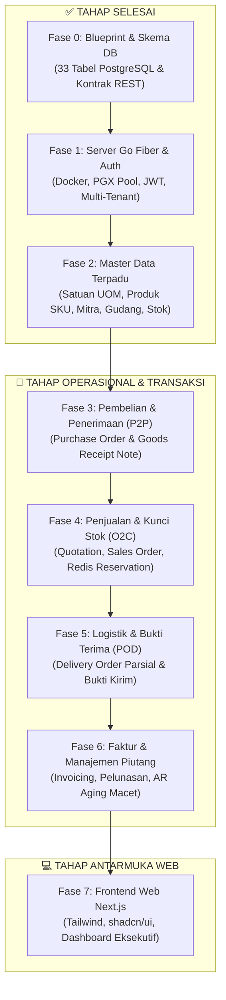
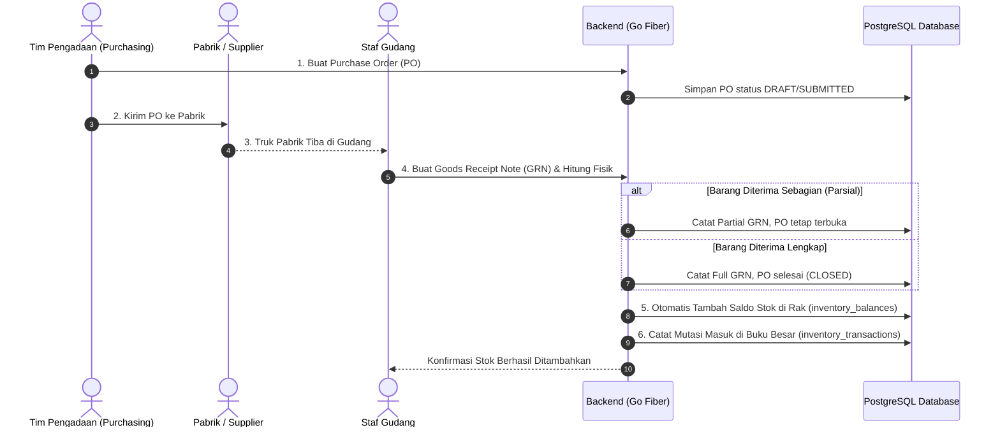
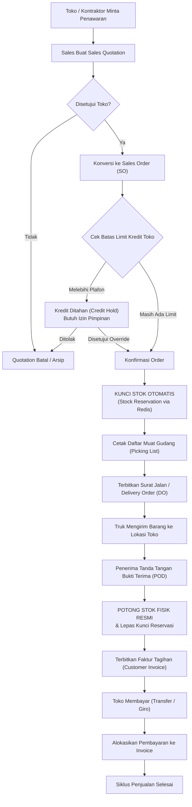
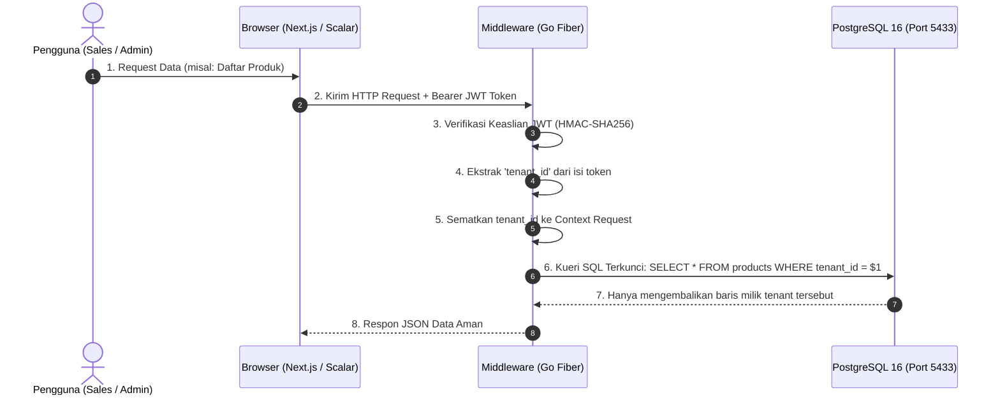
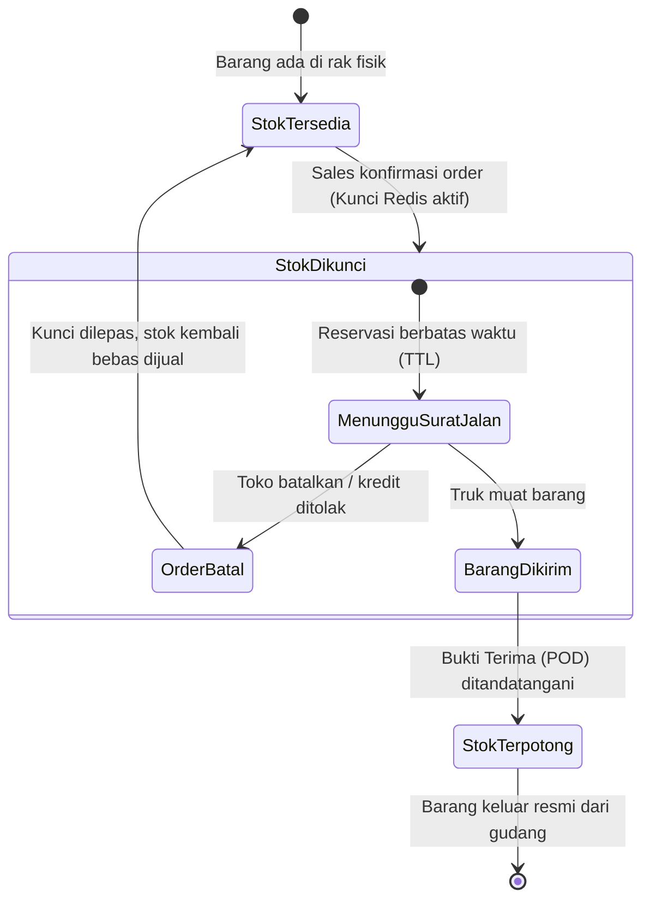

# DistribuCore — Panduan Lengkap Alur Kerja & Workflow Sistem

Dokumen ini berisi visualisasi grafis (diagram alur, sequence, dan state machine) serta penjelasan operasional lengkap untuk sistem **DistribuCore (B2B Distribution Management System)**.

---

## Daftar Isi
1. [Peta Jalan Alur Pengerjaan Proyek (Fase 0 s/d 7)](#1-peta-jalan-alur-pengerjaan-proyek)
2. [Alur Pembelian Barang (Procure-to-Pay / P2P)](#2-alur-pembelian-barang-procure-to-pay)
3. [Alur Penjualan & Pengiriman (Order-to-Cash / O2C)](#3-alur-penjualan--pengiriman-order-to-cash)
4. [Arsitektur Teknis & Isolasi Data Multi-Tenant](#4-arsitektur-teknis--isolasi-data-multi-tenant)
5. [Mekanisme Kunci Stok Real-Time (Stock Reservation)](#5-mekanisme-kunci-stok-real-time)

---

## 1. Peta Jalan Alur Pengerjaan Proyek

Diagram ini menunjukkan urutan pengerjaan teknis dari fondasi awal hingga aplikasi siap produksi:

---

## 2. Alur Pembelian Barang (Procure-to-Pay)

Alur ketika distributor memesan stok barang ke pabrik sampai barang masuk ke rak gudang:

---

## 3. Alur Penjualan & Pengiriman (Order-to-Cash)

Alur ketika sales menerima pesanan dari toko bangunan hingga uang pembayaran diterima:

---

## 4. Arsitektur Teknis & Isolasi Data Multi-Tenant

Bagaimana sistem memastikan data Perusahaan A tidak akan pernah bocor ke Perusahaan B:

---

## 5. Mekanisme Kunci Stok Real-Time (Stock Reservation)

Mencegah **penjualan ganda (double-selling)** saat banyak sales membuat order secara serentak:

---

### Rumus Perhitungan Ketersediaan Stok (Available-to-Promise):

$$\text{Stok Tersedia (ATP)} = \text{Stok Fisik di Rak} - \text{Stok Sedang Dikunci (Reserved)} - \text{Batas Stok Aman (Safety Stock)}$$

Dengan rumus ini, sales tidak akan pernah bisa menjanjikan barang yang fisiknya ada di gudang tetapi sebenarnya sudah dibayar/dipesan oleh pelanggan lain.
