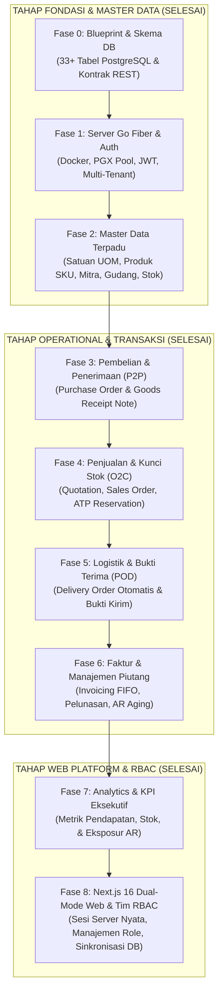
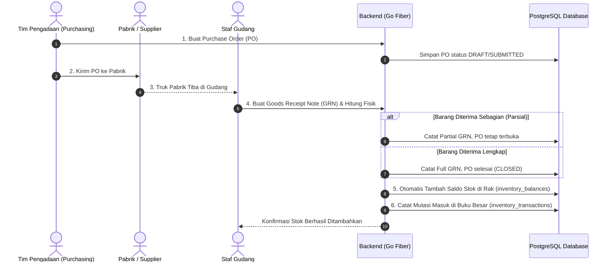
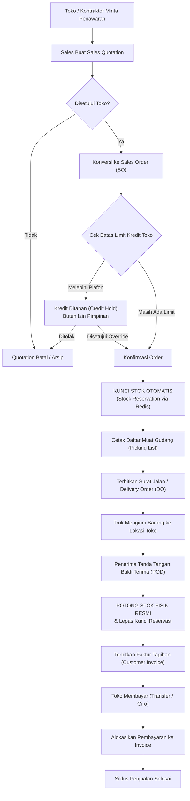
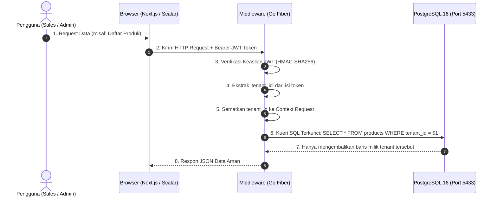
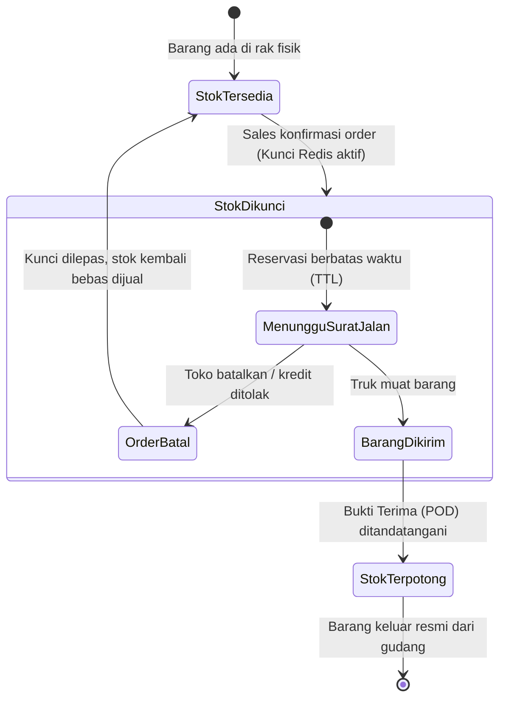

# DistribuCore — Panduan Lengkap Alur Kerja & Workflow Sistem

Dokumen ini berisi visualisasi grafis (diagram alur, sequence, dan state machine) serta penjelasan operasional lengkap untuk sistem **DistribuCore (B2B Distribution Management System)**.

---

## Daftar Isi
1. [Peta Jalan Alur Pengerjaan Proyek (Fase 0 s/d 8 — Selesai)](#1-peta-jalan-alur-pengerjaan-proyek)
2. [Alur Pembelian Barang (Procure-to-Pay / P2P)](#2-alur-pembelian-barang-procure-to-pay)
3. [Alur Penjualan & Pengiriman (Order-to-Cash / O2C)](#3-alur-penjualan--pengiriman-order-to-cash)
4. [Arsitektur Teknis & Isolasi Data Multi-Tenant](#4-arsitektur-teknis--isolasi-data-multi-tenant)
5. [Mekanisme Kunci Stok Real-Time (Stock Reservation)](#5-mekanisme-kunci-stok-real-time)
6. [Alur Manajemen Tim Tenant & Hak Akses Posisi (RBAC)](#6-alur-manajemen-tim-tenant--hak-akses-posisi-rbac)

---

## 1. Peta Jalan Alur Pengerjaan Proyek

Diagram ini menunjukkan urutan pengerjaan teknis dari fondasi awal hingga aplikasi produksi penuh (Fase 0 s/d Fase 8 telah selesai diimplementasikan):

---

## 2. Alur Pembelian Barang (Procure-to-Pay)

Alur ketika distributor memesan stok barang ke pabrik sampai barang masuk ke rak gudang:

---

## 3. Alur Penjualan & Pengiriman (Order-to-Cash)

Alur ketika sales menerima pesanan dari toko bangunan hingga uang pembayaran diterima:

---

## 4. Arsitektur Teknis & Isolasi Data Multi-Tenant

Bagaimana sistem memastikan data Perusahaan A tidak akan pernah bocor ke Perusahaan B:

---

## 5. Mekanisme Kunci Stok Real-Time (Stock Reservation)

Mencegah **penjualan ganda (double-selling)** saat banyak sales membuat order secara serentak:

---

### Rumus Perhitungan Ketersediaan Stok (Available-to-Promise):

$$\text{Stok Tersedia (ATP)} = \text{Stok Fisik di Rak} - \text{Stok Sedang Dikunci (Reserved)} - \text{Batas Stok Aman (Safety Stock)}$$

Dengan rumus ini, sales tidak akan pernah bisa menjanjikan barang yang fisiknya ada di gudang tetapi sebenarnya sudah dibayar/dipesan oleh pelanggan lain.

---

## 6. Alur Manajemen Tim Tenant & Hak Akses Posisi (RBAC)

Pada menu **Profil & Tim RBAC (`/demo/profile`)**, Administrator perusahaan (`ADMIN` / `OWNER`) dapat melihat seluruh pengguna yang terdaftar di tenant tersebut, menambahkan staf baru, serta mengubah posisi/role secara dinamis:

| Role / Posisi | Hak Akses Operasional Utama |
|---|---|
| `ADMIN` | Akses penuh ke seluruh modul operasional, keuangan, master data, dan manajemen anggota tim tenant (`GET/POST/PATCH/DELETE /api/v1/tenant/users`). |
| `SALES_MANAGER` | Membuat Pesanan Penjualan (SO), mengelola Katalog Produk (Master SKU), serta menambah/menghapus Pelanggan B2B. |
| `WAREHOUSE_MANAGER` | Mendaftarkan Gudang, membuat Purchase Order (PO), mengonfirmasi penerimaan barang (GRN), melakukan Cycle Count stok fisik, serta mengelola pengiriman (DO/POD). |
| `FINANCE_OFFICER` | Mengelola limit kredit pelanggan, menerbitkan faktur penagihan, mencatat pembayaran masuk (FIFO), dan memantau umur piutang (AR Aging). |
| `STAFF` | Akses baca (read-only) untuk memantau status operasional dan stok lintas modul tanpa hak modifikasi data. |

---

## 7. Alur Komunikasi B2B Otomatis via WhatsApp

Seluruh kontak nomor WhatsApp (`phone`) dan email (`email`) disimpan pada tabel PostgreSQL (`customers` dan `suppliers`) saat pendaftaran mitra bisnis, bukan dipaksakan saat login awal. Sistem memformat nomor Indonesia secara otomatis (`08xx` ke `628xx`) pada 4 titik komunikasi utama:

1. **Penagihan Piutang Jatuh Tempo (`Piutang AR Aging` `/demo/ar`)**: Tombol **Kirim Pengingat WA** membuka pesan resmi berisi total tunggakan (`Rp`) langsung ke nomor WhatsApp pelanggan.
2. **Pengiriman PO ke Pemasok (`Pembelian & GRN` `/demo/purchasing`)**: Tombol **Kirim PO via WA** mengirimkan rincian nomor PO, barang SKU, kuantitas, dan nilai order ke pemasok.
3. **Konfirmasi Sales Order & Review Kredit (`Pesanan Penjualan` `/demo/sales`)**: Tombol **Review kredit (WA)** dan **WA** mengirimkan status persetujuan limit kredit serta progres pengiriman ke pelanggan.
4. **Direktori Mitra B2B (`Pelanggan & Pemasok` `/demo/partners`)**: Tombol **Chat WA** pada setiap baris pelanggan dan pemasok untuk komunikasi cepat.
