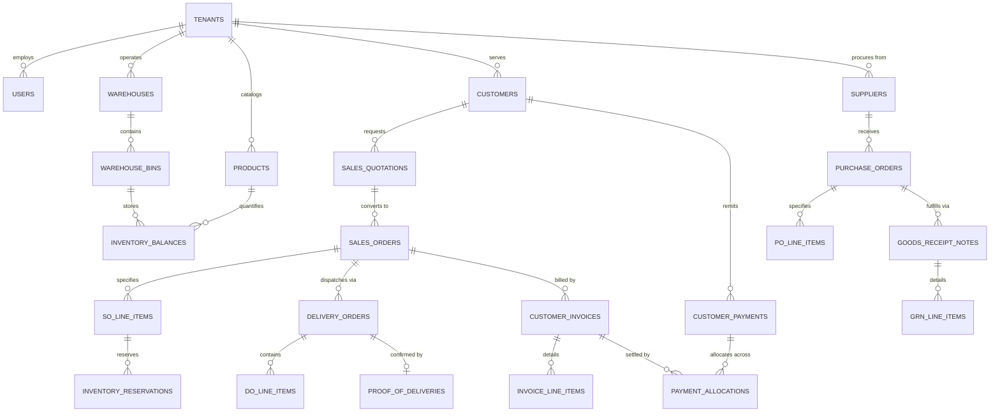

# DistribuCore Database Architecture & Relational Schema Specification

**Document Version:** 1.0.0  
**Phase:** 0 — Architectural Specification & Data Modeling  
**Target Engine:** PostgreSQL 15+  
**ORM / Data Access Layer:** SQLC with `pgx/v5`

---

## Table of Contents

1. [Architectural Principles & Multi-Tenancy](#1-architectural-principles--multi-tenancy)
2. [Domain Entity-Relationship Overview](#2-domain-entity-relationship-overview)
3. [Domain 1: Tenant & Identity Access Management (IAM)](#domain-1-tenant--identity-access-management-iam)
4. [Domain 2: Product Catalog, Units of Measure & Tiered Pricing](#domain-2-product-catalog-units-of-measure--tiered-pricing)
5. [Domain 3: Multi-Warehouse Inventory & Bin Management](#domain-3-multi-warehouse-inventory--bin-management)
6. [Domain 4: Procurement & Inbound Goods Receiving (P2P)](#domain-4-procurement--inbound-goods-receiving-p2p)
7. [Domain 5: Sales Quotations, Orders & Stock Reservation Engine](#domain-5-sales-quotations-orders--stock-reservation-engine)
8. [Domain 6: Outbound Fulfillment, Partial Deliveries & POD](#domain-6-outbound-fulfillment-partial-deliveries--pod)
9. [Domain 7: Invoicing, Payment Allocation & Accounts Receivable (O2C)](#domain-7-invoicing-payment-allocation--accounts-receivable-o2c)
10. [Indexing, Concurrency & Row-Level Security (RLS) Policies](#10-indexing-concurrency--row-level-security-rls-policies)

---

## 1. Architectural Principles & Multi-Tenancy

Every tenant-scoped table within DistribuCore adheres to strict architectural invariants:

1. **Immutable Tenant Discriminator:** Every tenant entity possesses a non-nullable `tenant_id UUID REFERENCES tenants(id) ON DELETE RESTRICT`. Cascading tenant deletes are strictly forbidden at the database layer to prevent catastrophic data loss.
2. **Compound Uniqueness Constraints:** Natural keys (e.g., SKU codes, order numbers, invoice numbers) are scoped uniquely per tenant:
   $$\text{UNIQUE}(\text{tenant\_id}, \text{code})$$
3. **Audit Trails & Soft Deletes:** Critical business records (orders, payments, inventory adjustments) are never physically deleted. They utilize an append-only event ledger or maintain `created_at`, `updated_at`, `deleted_at`, and `created_by` audit fields.
4. **Monetary Precision:** All monetary amounts are stored as integer values in minor currency units (cents) using `BIGINT` or high-precision fixed-point numeric types (`NUMERIC(15, 4)`), avoiding floating-point calculation errors.
5. **Quantity Precision:** Inventory counts and UOM conversion factors use `NUMERIC(12, 4)` to support bulk fractional quantities (e.g., metric tons, cubic meters, linear meters).

---

## 2. Domain Entity-Relationship Overview



---

## Domain 1: Tenant & Identity Access Management (IAM)

```sql
-- 1. Tenants (Operating Entities / SaaS Subscribers)
CREATE TABLE tenants (
    id UUID PRIMARY KEY DEFAULT gen_random_uuid(),
    code VARCHAR(32) NOT NULL UNIQUE,
    name VARCHAR(255) NOT NULL,
    tax_identifier VARCHAR(64),
    currency_code VARCHAR(3) NOT NULL DEFAULT 'USD',
    timezone VARCHAR(64) NOT NULL DEFAULT 'UTC',
    is_active BOOLEAN NOT NULL DEFAULT TRUE,
    created_at TIMESTAMPTZ NOT NULL DEFAULT NOW(),
    updated_at TIMESTAMPTZ NOT NULL DEFAULT NOW()
);

-- 2. Roles & Permissions (RBAC)
CREATE TABLE roles (
    id UUID PRIMARY KEY DEFAULT gen_random_uuid(),
    tenant_id UUID NOT NULL REFERENCES tenants(id) ON DELETE RESTRICT,
    name VARCHAR(64) NOT NULL,
    description TEXT,
    is_system_role BOOLEAN NOT NULL DEFAULT FALSE,
    created_at TIMESTAMPTZ NOT NULL DEFAULT NOW(),
    updated_at TIMESTAMPTZ NOT NULL DEFAULT NOW(),
    UNIQUE(tenant_id, name)
);

CREATE TABLE permissions (
    id VARCHAR(64) PRIMARY KEY, -- e.g. 'inventory:reserve', 'orders:approve'
    module VARCHAR(32) NOT NULL,
    description TEXT NOT NULL
);

CREATE TABLE role_permissions (
    role_id UUID NOT NULL REFERENCES roles(id) ON DELETE CASCADE,
    permission_id VARCHAR(64) NOT NULL REFERENCES permissions(id) ON DELETE CASCADE,
    PRIMARY KEY (role_id, permission_id)
);

-- 3. Users
CREATE TABLE users (
    id UUID PRIMARY KEY DEFAULT gen_random_uuid(),
    tenant_id UUID NOT NULL REFERENCES tenants(id) ON DELETE RESTRICT,
    email VARCHAR(255) NOT NULL,
    password_hash VARCHAR(255) NOT NULL,
    full_name VARCHAR(255) NOT NULL,
    phone_number VARCHAR(32),
    is_active BOOLEAN NOT NULL DEFAULT TRUE,
    last_login_at TIMESTAMPTZ,
    created_at TIMESTAMPTZ NOT NULL DEFAULT NOW(),
    updated_at TIMESTAMPTZ NOT NULL DEFAULT NOW(),
    UNIQUE(tenant_id, email)
);

CREATE TABLE user_roles (
    user_id UUID NOT NULL REFERENCES users(id) ON DELETE CASCADE,
    role_id UUID NOT NULL REFERENCES roles(id) ON DELETE CASCADE,
    PRIMARY KEY (user_id, role_id)
);
```

---

## Domain 2: Product Catalog, Units of Measure & Tiered Pricing

```sql
-- 1. Units of Measure (UOM)
CREATE TABLE units_of_measure (
    id UUID PRIMARY KEY DEFAULT gen_random_uuid(),
    tenant_id UUID NOT NULL REFERENCES tenants(id) ON DELETE RESTRICT,
    code VARCHAR(16) NOT NULL, -- e.g. 'PCS', 'BOX', 'PLT' (Pallet), 'KG', 'M3'
    name VARCHAR(64) NOT NULL,
    is_base_unit BOOLEAN NOT NULL DEFAULT FALSE,
    created_at TIMESTAMPTZ NOT NULL DEFAULT NOW(),
    UNIQUE(tenant_id, code)
);

-- 2. Product Categories
CREATE TABLE product_categories (
    id UUID PRIMARY KEY DEFAULT gen_random_uuid(),
    tenant_id UUID NOT NULL REFERENCES tenants(id) ON DELETE RESTRICT,
    parent_id UUID REFERENCES product_categories(id) ON DELETE SET NULL,
    name VARCHAR(128) NOT NULL,
    slug VARCHAR(128) NOT NULL,
    created_at TIMESTAMPTZ NOT NULL DEFAULT NOW(),
    UNIQUE(tenant_id, slug)
);

-- 3. Master Products
CREATE TABLE products (
    id UUID PRIMARY KEY DEFAULT gen_random_uuid(),
    tenant_id UUID NOT NULL REFERENCES tenants(id) ON DELETE RESTRICT,
    category_id UUID REFERENCES product_categories(id) ON DELETE SET NULL,
    sku VARCHAR(64) NOT NULL,
    barcode VARCHAR(64),
    name VARCHAR(255) NOT NULL,
    description TEXT,
    base_uom_id UUID NOT NULL REFERENCES units_of_measure(id) ON DELETE RESTRICT,
    safety_stock_quantity NUMERIC(12, 4) NOT NULL DEFAULT 0.0000,
    reorder_point_quantity NUMERIC(12, 4) NOT NULL DEFAULT 0.0000,
    is_active BOOLEAN NOT NULL DEFAULT TRUE,
    created_at TIMESTAMPTZ NOT NULL DEFAULT NOW(),
    updated_at TIMESTAMPTZ NOT NULL DEFAULT NOW(),
    UNIQUE(tenant_id, sku)
);

-- 4. UOM Conversion Rules
CREATE TABLE product_uom_conversions (
    id UUID PRIMARY KEY DEFAULT gen_random_uuid(),
    tenant_id UUID NOT NULL REFERENCES tenants(id) ON DELETE RESTRICT,
    product_id UUID NOT NULL REFERENCES products(id) ON DELETE CASCADE,
    from_uom_id UUID NOT NULL REFERENCES units_of_measure(id) ON DELETE RESTRICT,
    to_uom_id UUID NOT NULL REFERENCES units_of_measure(id) ON DELETE RESTRICT,
    conversion_factor NUMERIC(12, 6) NOT NULL, -- e.g., 1 Box = 24 PCS (factor = 24.000000)
    UNIQUE(tenant_id, product_id, from_uom_id, to_uom_id)
);

-- 5. Tiered Pricing Matrices (Wholesale, Contractor, Retail)
CREATE TABLE price_tiers (
    id UUID PRIMARY KEY DEFAULT gen_random_uuid(),
    tenant_id UUID NOT NULL REFERENCES tenants(id) ON DELETE RESTRICT,
    name VARCHAR(64) NOT NULL, -- 'Tier 1 - Wholesale', 'Tier 2 - Contractor', 'Standard Retail'
    currency_code VARCHAR(3) NOT NULL DEFAULT 'USD',
    is_default BOOLEAN NOT NULL DEFAULT FALSE,
    UNIQUE(tenant_id, name)
);

CREATE TABLE product_prices (
    id UUID PRIMARY KEY DEFAULT gen_random_uuid(),
    tenant_id UUID NOT NULL REFERENCES tenants(id) ON DELETE RESTRICT,
    product_id UUID NOT NULL REFERENCES products(id) ON DELETE CASCADE,
    price_tier_id UUID NOT NULL REFERENCES price_tiers(id) ON DELETE CASCADE,
    uom_id UUID NOT NULL REFERENCES units_of_measure(id) ON DELETE RESTRICT,
    min_order_quantity NUMERIC(12, 4) NOT NULL DEFAULT 1.0000,
    unit_price_cents BIGINT NOT NULL, -- Integer minor currency unit
    effective_from TIMESTAMPTZ NOT NULL DEFAULT NOW(),
    effective_to TIMESTAMPTZ,
    UNIQUE(tenant_id, product_id, price_tier_id, uom_id, min_order_quantity)
);
```

---

## Domain 3: Multi-Warehouse Inventory & Bin Management

```sql
-- 1. Warehouses (Facilities)
CREATE TABLE warehouses (
    id UUID PRIMARY KEY DEFAULT gen_random_uuid(),
    tenant_id UUID NOT NULL REFERENCES tenants(id) ON DELETE RESTRICT,
    code VARCHAR(32) NOT NULL,
    name VARCHAR(128) NOT NULL,
    address_line TEXT,
    city VARCHAR(64),
    state_province VARCHAR(64),
    postal_code VARCHAR(16),
    is_active BOOLEAN NOT NULL DEFAULT TRUE,
    created_at TIMESTAMPTZ NOT NULL DEFAULT NOW(),
    UNIQUE(tenant_id, code)
);

-- 2. Storage Bins / Locations
CREATE TABLE warehouse_bins (
    id UUID PRIMARY KEY DEFAULT gen_random_uuid(),
    tenant_id UUID NOT NULL REFERENCES tenants(id) ON DELETE RESTRICT,
    warehouse_id UUID NOT NULL REFERENCES warehouses(id) ON DELETE CASCADE,
    code VARCHAR(32) NOT NULL, -- e.g., 'A1-R02-B04' (Aisle 1, Rack 2, Bin 4)
    zone VARCHAR(32),
    is_active BOOLEAN NOT NULL DEFAULT TRUE,
    UNIQUE(tenant_id, warehouse_id, code)
);

-- 3. On-Hand Physical Inventory Balances
CREATE TABLE inventory_balances (
    id UUID PRIMARY KEY DEFAULT gen_random_uuid(),
    tenant_id UUID NOT NULL REFERENCES tenants(id) ON DELETE RESTRICT,
    warehouse_id UUID NOT NULL REFERENCES warehouses(id) ON DELETE RESTRICT,
    bin_id UUID NOT NULL REFERENCES warehouse_bins(id) ON DELETE RESTRICT,
    product_id UUID NOT NULL REFERENCES products(id) ON DELETE RESTRICT,
    quantity_on_hand NUMERIC(12, 4) NOT NULL DEFAULT 0.0000 CHECK (quantity_on_hand >= 0),
    updated_at TIMESTAMPTZ NOT NULL DEFAULT NOW(),
    UNIQUE(tenant_id, warehouse_id, bin_id, product_id)
);

-- 4. Immutable Inventory Ledger (Transaction History)
CREATE TABLE inventory_transactions (
    id UUID PRIMARY KEY DEFAULT gen_random_uuid(),
    tenant_id UUID NOT NULL REFERENCES tenants(id) ON DELETE RESTRICT,
    warehouse_id UUID NOT NULL REFERENCES warehouses(id) ON DELETE RESTRICT,
    bin_id UUID NOT NULL REFERENCES warehouse_bins(id) ON DELETE RESTRICT,
    product_id UUID NOT NULL REFERENCES products(id) ON DELETE RESTRICT,
    transaction_type VARCHAR(32) NOT NULL, -- 'GRN_RECEIPT', 'DISPATCH', 'TRANSFER_IN', 'TRANSFER_OUT', 'ADJUSTMENT_CYCLE_COUNT'
    quantity_delta NUMERIC(12, 4) NOT NULL, -- Positive for inbound, negative for outbound
    reference_type VARCHAR(32) NOT NULL, -- 'PURCHASE_ORDER', 'DELIVERY_ORDER', 'AUDIT_ADJUSTMENT'
    reference_id UUID NOT NULL,
    performed_by UUID NOT NULL REFERENCES users(id) ON DELETE RESTRICT,
    notes TEXT,
    created_at TIMESTAMPTZ NOT NULL DEFAULT NOW()
);
```

---

## Domain 4: Procurement & Inbound Goods Receiving (P2P)

```sql
-- 1. Suppliers / Vendors
CREATE TABLE suppliers (
    id UUID PRIMARY KEY DEFAULT gen_random_uuid(),
    tenant_id UUID NOT NULL REFERENCES tenants(id) ON DELETE RESTRICT,
    code VARCHAR(32) NOT NULL,
    company_name VARCHAR(255) NOT NULL,
    contact_person VARCHAR(128),
    email VARCHAR(255),
    phone VARCHAR(32),
    payment_terms_days INT NOT NULL DEFAULT 30,
    is_active BOOLEAN NOT NULL DEFAULT TRUE,
    created_at TIMESTAMPTZ NOT NULL DEFAULT NOW(),
    UNIQUE(tenant_id, code)
);

-- 2. Purchase Orders (PO)
CREATE TABLE purchase_orders (
    id UUID PRIMARY KEY DEFAULT gen_random_uuid(),
    tenant_id UUID NOT NULL REFERENCES tenants(id) ON DELETE RESTRICT,
    po_number VARCHAR(64) NOT NULL,
    supplier_id UUID NOT NULL REFERENCES suppliers(id) ON DELETE RESTRICT,
    destination_warehouse_id UUID NOT NULL REFERENCES warehouses(id) ON DELETE RESTRICT,
    status VARCHAR(32) NOT NULL DEFAULT 'DRAFT', -- 'DRAFT', 'SUBMITTED', 'PARTIALLY_RECEIVED', 'RECEIVED', 'CANCELLED'
    issued_date DATE NOT NULL DEFAULT CURRENT_DATE,
    expected_delivery_date DATE,
    total_amount_cents BIGINT NOT NULL DEFAULT 0,
    created_by UUID NOT NULL REFERENCES users(id) ON DELETE RESTRICT,
    created_at TIMESTAMPTZ NOT NULL DEFAULT NOW(),
    updated_at TIMESTAMPTZ NOT NULL DEFAULT NOW(),
    UNIQUE(tenant_id, po_number)
);

CREATE TABLE po_line_items (
    id UUID PRIMARY KEY DEFAULT gen_random_uuid(),
    tenant_id UUID NOT NULL REFERENCES tenants(id) ON DELETE RESTRICT,
    purchase_order_id UUID NOT NULL REFERENCES purchase_orders(id) ON DELETE CASCADE,
    product_id UUID NOT NULL REFERENCES products(id) ON DELETE RESTRICT,
    uom_id UUID NOT NULL REFERENCES units_of_measure(id) ON DELETE RESTRICT,
    ordered_quantity NUMERIC(12, 4) NOT NULL CHECK (ordered_quantity > 0),
    received_quantity NUMERIC(12, 4) NOT NULL DEFAULT 0.0000,
    unit_cost_cents BIGINT NOT NULL,
    subtotal_cents BIGINT NOT NULL
);

-- 3. Goods Receipt Notes (GRN)
CREATE TABLE goods_receipt_notes (
    id UUID PRIMARY KEY DEFAULT gen_random_uuid(),
    tenant_id UUID NOT NULL REFERENCES tenants(id) ON DELETE RESTRICT,
    grn_number VARCHAR(64) NOT NULL,
    purchase_order_id UUID NOT NULL REFERENCES purchase_orders(id) ON DELETE RESTRICT,
    warehouse_id UUID NOT NULL REFERENCES warehouses(id) ON DELETE RESTRICT,
    received_date TIMESTAMPTZ NOT NULL DEFAULT NOW(),
    received_by UUID NOT NULL REFERENCES users(id) ON DELETE RESTRICT,
    supplier_delivery_note_ref VARCHAR(64),
    status VARCHAR(32) NOT NULL DEFAULT 'COMPLETED',
    UNIQUE(tenant_id, grn_number)
);

CREATE TABLE grn_line_items (
    id UUID PRIMARY KEY DEFAULT gen_random_uuid(),
    tenant_id UUID NOT NULL REFERENCES tenants(id) ON DELETE RESTRICT,
    grn_id UUID NOT NULL REFERENCES goods_receipt_notes(id) ON DELETE CASCADE,
    po_line_item_id UUID NOT NULL REFERENCES po_line_items(id) ON DELETE RESTRICT,
    product_id UUID NOT NULL REFERENCES products(id) ON DELETE RESTRICT,
    target_bin_id UUID NOT NULL REFERENCES warehouse_bins(id) ON DELETE RESTRICT,
    quantity_received NUMERIC(12, 4) NOT NULL CHECK (quantity_received > 0)
);
```

---

## Domain 5: Sales Quotations, Orders & Stock Reservation Engine

```sql
-- 1. Customers
CREATE TABLE customers (
    id UUID PRIMARY KEY DEFAULT gen_random_uuid(),
    tenant_id UUID NOT NULL REFERENCES tenants(id) ON DELETE RESTRICT,
    code VARCHAR(32) NOT NULL,
    company_name VARCHAR(255) NOT NULL,
    contact_person VARCHAR(128),
    email VARCHAR(255),
    phone VARCHAR(32),
    price_tier_id UUID REFERENCES price_tiers(id) ON DELETE RESTRICT,
    credit_limit_cents BIGINT NOT NULL DEFAULT 0,
    outstanding_balance_cents BIGINT NOT NULL DEFAULT 0,
    payment_terms_days INT NOT NULL DEFAULT 30,
    is_credit_held BOOLEAN NOT NULL DEFAULT FALSE,
    is_active BOOLEAN NOT NULL DEFAULT TRUE,
    created_at TIMESTAMPTZ NOT NULL DEFAULT NOW(),
    UNIQUE(tenant_id, code)
);

-- 2. Sales Quotations
CREATE TABLE sales_quotations (
    id UUID PRIMARY KEY DEFAULT gen_random_uuid(),
    tenant_id UUID NOT NULL REFERENCES tenants(id) ON DELETE RESTRICT,
    quote_number VARCHAR(64) NOT NULL,
    customer_id UUID NOT NULL REFERENCES customers(id) ON DELETE RESTRICT,
    status VARCHAR(32) NOT NULL DEFAULT 'DRAFT', -- 'DRAFT', 'SENT', 'ACCEPTED', 'EXPIRED', 'CONVERTED'
    valid_until DATE NOT NULL,
    subtotal_cents BIGINT NOT NULL DEFAULT 0,
    tax_cents BIGINT NOT NULL DEFAULT 0,
    total_amount_cents BIGINT NOT NULL DEFAULT 0,
    created_by UUID NOT NULL REFERENCES users(id) ON DELETE RESTRICT,
    created_at TIMESTAMPTZ NOT NULL DEFAULT NOW(),
    UNIQUE(tenant_id, quote_number)
);

-- 3. Sales Orders
CREATE TABLE sales_orders (
    id UUID PRIMARY KEY DEFAULT gen_random_uuid(),
    tenant_id UUID NOT NULL REFERENCES tenants(id) ON DELETE RESTRICT,
    order_number VARCHAR(64) NOT NULL,
    quotation_id UUID REFERENCES sales_quotations(id) ON DELETE SET NULL,
    customer_id UUID NOT NULL REFERENCES customers(id) ON DELETE RESTRICT,
    order_status VARCHAR(32) NOT NULL DEFAULT 'PENDING_APPROVAL', -- 'PENDING_APPROVAL', 'CONFIRMED', 'PARTIALLY_FULFILLED', 'FULFILLED', 'CANCELLED'
    credit_status VARCHAR(32) NOT NULL DEFAULT 'PENDING', -- 'APPROVED', 'CREDIT_HOLD', 'OVERRIDDEN'
    total_amount_cents BIGINT NOT NULL DEFAULT 0,
    order_date TIMESTAMPTZ NOT NULL DEFAULT NOW(),
    created_by UUID NOT NULL REFERENCES users(id) ON DELETE RESTRICT,
    created_at TIMESTAMPTZ NOT NULL DEFAULT NOW(),
    updated_at TIMESTAMPTZ NOT NULL DEFAULT NOW(),
    UNIQUE(tenant_id, order_number)
);

CREATE TABLE so_line_items (
    id UUID PRIMARY KEY DEFAULT gen_random_uuid(),
    tenant_id UUID NOT NULL REFERENCES tenants(id) ON DELETE RESTRICT,
    sales_order_id UUID NOT NULL REFERENCES sales_orders(id) ON DELETE CASCADE,
    product_id UUID NOT NULL REFERENCES products(id) ON DELETE RESTRICT,
    uom_id UUID NOT NULL REFERENCES units_of_measure(id) ON DELETE RESTRICT,
    ordered_quantity NUMERIC(12, 4) NOT NULL CHECK (ordered_quantity > 0),
    reserved_quantity NUMERIC(12, 4) NOT NULL DEFAULT 0.0000,
    delivered_quantity NUMERIC(12, 4) NOT NULL DEFAULT 0.0000,
    unit_price_cents BIGINT NOT NULL,
    subtotal_cents BIGINT NOT NULL
);

-- 4. High-Concurrency Stock Reservation Table
CREATE TABLE inventory_reservations (
    id UUID PRIMARY KEY DEFAULT gen_random_uuid(),
    tenant_id UUID NOT NULL REFERENCES tenants(id) ON DELETE RESTRICT,
    so_line_item_id UUID NOT NULL REFERENCES so_line_items(id) ON DELETE CASCADE,
    product_id UUID NOT NULL REFERENCES products(id) ON DELETE RESTRICT,
    warehouse_id UUID NOT NULL REFERENCES warehouses(id) ON DELETE RESTRICT,
    reserved_quantity NUMERIC(12, 4) NOT NULL CHECK (reserved_quantity > 0),
    status VARCHAR(32) NOT NULL DEFAULT 'ACTIVE', -- 'ACTIVE', 'RELEASED', 'FULFILLED', 'EXPIRED'
    expires_at TIMESTAMPTZ NOT NULL,
    created_at TIMESTAMPTZ NOT NULL DEFAULT NOW()
);
```

---

## Domain 6: Outbound Fulfillment, Partial Deliveries & POD

```sql
-- 1. Delivery Orders (DO) / Dispatch Notes
CREATE TABLE delivery_orders (
    id UUID PRIMARY KEY DEFAULT gen_random_uuid(),
    tenant_id UUID NOT NULL REFERENCES tenants(id) ON DELETE RESTRICT,
    delivery_number VARCHAR(64) NOT NULL,
    sales_order_id UUID NOT NULL REFERENCES sales_orders(id) ON DELETE RESTRICT,
    origin_warehouse_id UUID NOT NULL REFERENCES warehouses(id) ON DELETE RESTRICT,
    delivery_status VARCHAR(32) NOT NULL DEFAULT 'STAGED', -- 'STAGED', 'DISPATCHED', 'DELIVERED', 'FAILED'
    driver_name VARCHAR(128),
    vehicle_registration VARCHAR(32),
    dispatched_at TIMESTAMPTZ,
    created_at TIMESTAMPTZ NOT NULL DEFAULT NOW(),
    UNIQUE(tenant_id, delivery_number)
);

CREATE TABLE do_line_items (
    id UUID PRIMARY KEY DEFAULT gen_random_uuid(),
    tenant_id UUID NOT NULL REFERENCES tenants(id) ON DELETE RESTRICT,
    delivery_order_id UUID NOT NULL REFERENCES delivery_orders(id) ON DELETE CASCADE,
    so_line_item_id UUID NOT NULL REFERENCES so_line_items(id) ON DELETE RESTRICT,
    product_id UUID NOT NULL REFERENCES products(id) ON DELETE RESTRICT,
    source_bin_id UUID NOT NULL REFERENCES warehouse_bins(id) ON DELETE RESTRICT,
    quantity_to_deliver NUMERIC(12, 4) NOT NULL CHECK (quantity_to_deliver > 0)
);

-- 2. Proof of Delivery (POD)
CREATE TABLE proof_of_deliveries (
    id UUID PRIMARY KEY DEFAULT gen_random_uuid(),
    tenant_id UUID NOT NULL REFERENCES tenants(id) ON DELETE RESTRICT,
    delivery_order_id UUID NOT NULL UNIQUE REFERENCES delivery_orders(id) ON DELETE RESTRICT,
    recipient_name VARCHAR(128) NOT NULL,
    recipient_signature_url TEXT,
    delivery_photo_url TEXT,
    delivery_confirmed_at TIMESTAMPTZ NOT NULL DEFAULT NOW(),
    received_status VARCHAR(32) NOT NULL DEFAULT 'ACCEPTED_FULL', -- 'ACCEPTED_FULL', 'ACCEPTED_PARTIAL', 'REJECTED'
    rejection_reason TEXT,
    created_at TIMESTAMPTZ NOT NULL DEFAULT NOW()
);
```

---

## Domain 7: Invoicing, Payment Allocation & Accounts Receivable (O2C)

```sql
-- 1. Customer Invoices
CREATE TABLE customer_invoices (
    id UUID PRIMARY KEY DEFAULT gen_random_uuid(),
    tenant_id UUID NOT NULL REFERENCES tenants(id) ON DELETE RESTRICT,
    invoice_number VARCHAR(64) NOT NULL,
    customer_id UUID NOT NULL REFERENCES customers(id) ON DELETE RESTRICT,
    sales_order_id UUID REFERENCES sales_orders(id) ON DELETE SET NULL,
    delivery_order_id UUID REFERENCES delivery_orders(id) ON DELETE SET NULL,
    status VARCHAR(32) NOT NULL DEFAULT 'ISSUED', -- 'ISSUED', 'PARTIALLY_PAID', 'PAID', 'VOID'
    issue_date DATE NOT NULL DEFAULT CURRENT_DATE,
    due_date DATE NOT NULL,
    subtotal_cents BIGINT NOT NULL,
    tax_cents BIGINT NOT NULL DEFAULT 0,
    total_amount_cents BIGINT NOT NULL,
    balance_due_cents BIGINT NOT NULL,
    created_at TIMESTAMPTZ NOT NULL DEFAULT NOW(),
    updated_at TIMESTAMPTZ NOT NULL DEFAULT NOW(),
    UNIQUE(tenant_id, invoice_number)
);

CREATE TABLE invoice_line_items (
    id UUID PRIMARY KEY DEFAULT gen_random_uuid(),
    tenant_id UUID NOT NULL REFERENCES tenants(id) ON DELETE RESTRICT,
    invoice_id UUID NOT NULL REFERENCES customer_invoices(id) ON DELETE CASCADE,
    product_id UUID NOT NULL REFERENCES products(id) ON DELETE RESTRICT,
    quantity NUMERIC(12, 4) NOT NULL,
    unit_price_cents BIGINT NOT NULL,
    subtotal_cents BIGINT NOT NULL
);

-- 2. Customer Payments
CREATE TABLE customer_payments (
    id UUID PRIMARY KEY DEFAULT gen_random_uuid(),
    tenant_id UUID NOT NULL REFERENCES tenants(id) ON DELETE RESTRICT,
    payment_number VARCHAR(64) NOT NULL,
    customer_id UUID NOT NULL REFERENCES customers(id) ON DELETE RESTRICT,
    payment_method VARCHAR(32) NOT NULL, -- 'BANK_TRANSFER', 'CHEQUE', 'CASH', 'CREDIT_CARD'
    payment_date DATE NOT NULL DEFAULT CURRENT_DATE,
    amount_cents BIGINT NOT NULL CHECK (amount_cents > 0),
    unallocated_cents BIGINT NOT NULL,
    reference_number VARCHAR(64),
    received_by UUID NOT NULL REFERENCES users(id) ON DELETE RESTRICT,
    created_at TIMESTAMPTZ NOT NULL DEFAULT NOW(),
    UNIQUE(tenant_id, payment_number)
);

-- 3. Payment Allocations (Settles specific invoices)
CREATE TABLE payment_allocations (
    id UUID PRIMARY KEY DEFAULT gen_random_uuid(),
    tenant_id UUID NOT NULL REFERENCES tenants(id) ON DELETE RESTRICT,
    payment_id UUID NOT NULL REFERENCES customer_payments(id) ON DELETE CASCADE,
    invoice_id UUID NOT NULL REFERENCES customer_invoices(id) ON DELETE RESTRICT,
    allocated_amount_cents BIGINT NOT NULL CHECK (allocated_amount_cents > 0),
    allocated_at TIMESTAMPTZ NOT NULL DEFAULT NOW(),
    allocated_by UUID NOT NULL REFERENCES users(id) ON DELETE RESTRICT
);
```

---

## 10. Indexing, Concurrency & Row-Level Security (RLS) Policies

### Primary Performance Indexes

```sql
-- Inventory Lookups & Available-to-Promise (ATP)
CREATE INDEX idx_inv_bal_product_wh ON inventory_balances (tenant_id, product_id, warehouse_id);
CREATE INDEX idx_inv_res_active ON inventory_reservations (tenant_id, product_id, warehouse_id) WHERE status = 'ACTIVE';

-- Accounts Receivable Aging
CREATE INDEX idx_invoices_ar_aging ON customer_invoices (tenant_id, customer_id, due_date) WHERE balance_due_cents > 0;

-- Sales Order & Dispatch Queues
CREATE INDEX idx_so_status ON sales_orders (tenant_id, order_status);
CREATE INDEX idx_do_status ON delivery_orders (tenant_id, delivery_status);
```

### Row-Level Security (RLS) Template

```sql
-- Enable RLS across tenant-scoped tables
ALTER TABLE products ENABLE ROW LEVEL SECURITY;
ALTER TABLE inventory_balances ENABLE ROW LEVEL SECURITY;
ALTER TABLE sales_orders ENABLE ROW LEVEL SECURITY;
ALTER TABLE customer_invoices ENABLE ROW LEVEL SECURITY;

-- Tenant Isolation Policy Example for 'products'
CREATE POLICY tenant_isolation_policy ON products
    FOR ALL
    USING (tenant_id = NULLIF(current_setting('app.current_tenant_id', true), '')::UUID);
```
